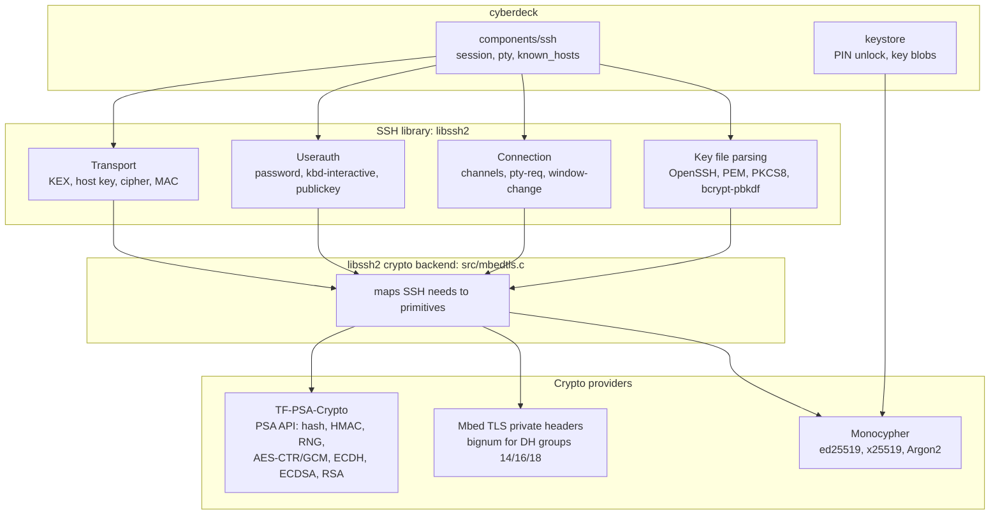
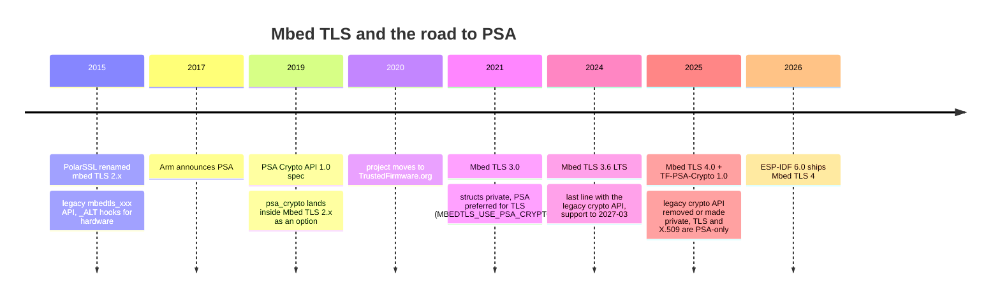
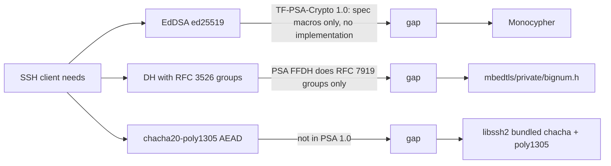

# Crypto libraries and SSH: a map

Orientation note for the SSH stack. Decisions live in
[ssh-stack-options.md](ssh-stack-options.md) and
[idf6-migration.md](idf6-migration.md); this is the map behind them.

## The moving parts

An SSH client is three protocol layers on top of a bag of primitives. The
primitives are where the library choice bites.

What each SSH step consumes:

| SSH step | Primitive | Where it comes from today |
|---|---|---|
| KEX curve25519-sha256 | X25519, SHA-256 | Monocypher, PSA |
| KEX DH group14/16/18, GEX | big integers, RFC 3526 primes | Mbed TLS bignum (private) |
| Host key ssh-ed25519 | EdDSA verify | Monocypher |
| Host key ecdsa, rsa | ECDSA, RSA verify | PSA (legacy API today, PSA after a port) |
| User key auth | EdDSA / ECDSA / RSA sign | same as above |
| Encrypted OpenSSH key | bcrypt-pbkdf = Blowfish + SHA-512 | libssh2's own Blowfish, PSA hash |
| Packet cipher | AES-256-CTR, AES-GCM, chacha20-poly1305 | PSA cipher/AEAD, libssh2's own chacha |
| Packet MAC | HMAC-SHA2 | PSA |
| Randomness | CSPRNG | PSA `psa_generate_random` |
| Keystore wrap | Argon2id, chacha20-poly1305 | Monocypher |

## What PSA is and where it came from

PSA stands for Platform Security Architecture, an Arm programme from 2017 for
securing Cortex-M devices (threat models, firmware framework, certification).
Its crypto piece is the **PSA Certified Crypto API**: a C interface where the
caller never holds raw key bytes. Keys are created with attributes (type,
size, allowed algorithms, allowed usages), referred to by an id, and every
operation is checked against that policy. Keys can live in software, in a
TrustZone partition or in a secure element behind a driver, and the caller's
code does not change.

Mbed TLS became the reference implementation. In 2020 the project moved from
Arm to TrustedFirmware.org. The PSA code grew inside Mbed TLS until 4.0 split
it out as its own library, TF-PSA-Crypto.

## Why the move

- **Key isolation.** With the legacy API every consumer holds `mbedtls_rsa_context`
  with the private exponent inside. PSA holds a handle. Hardware-backed keys
  need this shape.
- **One driver model.** The old way to use a crypto accelerator was the
  `MBEDTLS_xxx_ALT` macro: replace a whole module with your own. PSA replaces
  it with transparent and opaque drivers behind the same API. Espressif's
  AES and SHA accelerators are wired in that way in IDF 6.
- **Policy enforcement.** A key created for ECDSA-SHA256 cannot be used for
  ECDH by mistake. Good for safety, painful for porting: most of the bugs in
  libssh2's PR #2284 are missing usage flags.
- **One code path.** Mbed TLS 3.x carried both APIs and twice the test matrix.

## What is wrong with Mbed TLS 3

Nothing functional. 3.6 is a long-term support line and works. Three facts
retire it for us:

1. Support ends 2027-03; ESP-IDF 6 already moved to 4.0, and 5.5 is out of
   its service period.
2. The legacy API is deprecated upstream. Code written against it is code
   that will have to move anyway.
3. Two copies of Mbed TLS cannot share one image (same symbol names), so a
   component cannot keep 3.6 for itself while the SDK runs 4.0.

## What Mbed TLS 4 does not give an SSH client

This is why a "pure PSA" libssh2 on Mbed TLS 4 cannot exist: the DH groups
that every sshd still offers as fallback force the private bignum header, and
ed25519 needs a second provider. Monocypher (MIT, ~2k lines, constant-time)
fills the ed25519 and Argon2 holes for both libssh2 and the keystore.

## Who provides what

| Provider | Hash/HMAC | AES-CTR/GCM | chacha20-poly1305 | X25519 | ed25519 | ECDSA/RSA | DH bignum | Argon2 | Size, license |
|---|---|---|---|---|---|---|---|---|---|
| TF-PSA-Crypto 1.0 (in IDF 6) | yes | yes | no | yes | no | yes | private | no | in SDK, Apache-2.0 |
| Monocypher 4 | BLAKE2, SHA-512 | no | yes | yes | yes | no | no | yes | tiny, MIT |
| wolfCrypt (wolfSSL) | yes | yes | yes | yes | yes | yes | yes | no | mid, GPLv2/commercial |
| libsodium | partial | no | yes | yes | yes | no | no | yes | small, ISC |
| OpenSSL 3 | yes | yes | yes | yes | yes | yes | yes | no | large, Apache-2.0 |

And the SSH libraries sitting on them:

| SSH library | Crypto backends | ed25519 on Mbed TLS | Mbed TLS 4 | Role |
|---|---|---|---|---|
| libssh2 (our fork) | OpenSSL, wolfSSL, Mbed TLS, WinCNG, libgcrypt | via our Monocypher commit | PSA port in the fork (`feature/mbedtls-psa`); bignum header only | client only, small |
| libssh | OpenSSL, Mbed TLS, libgcrypt | yes, own code | none merged | client and server, large |
| wolfSSH | wolfCrypt only | n/a, native | n/a | client and server, GPLv3 |
| Dropbear | own libtomcrypt | yes | n/a | programs, not a library |

## Reading guide

- PSA Crypto API spec: arm-software.github.io/psa-api/crypto
- Mbed TLS 4.0 migration guide and TF-PSA-Crypto repo on github.com/Mbed-TLS
- libssh2 backend contract: `src/crypto.h` lists every primitive a backend must supply
- Our backend: `src/mbedtls.c` in the sigman78/libssh2 fork, plus
  `components/libssh2_esp/patches/0002-mbedtls4-private-api.patch`
